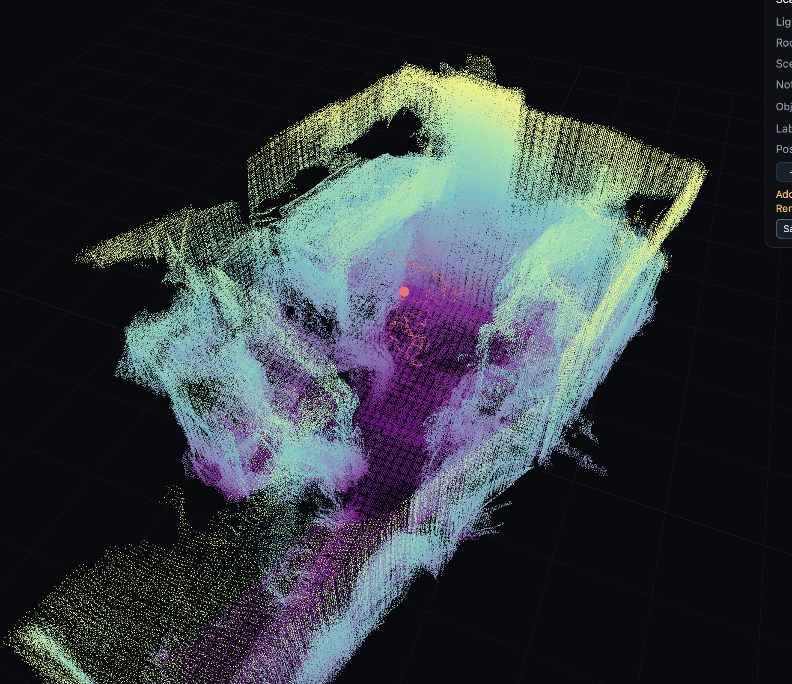
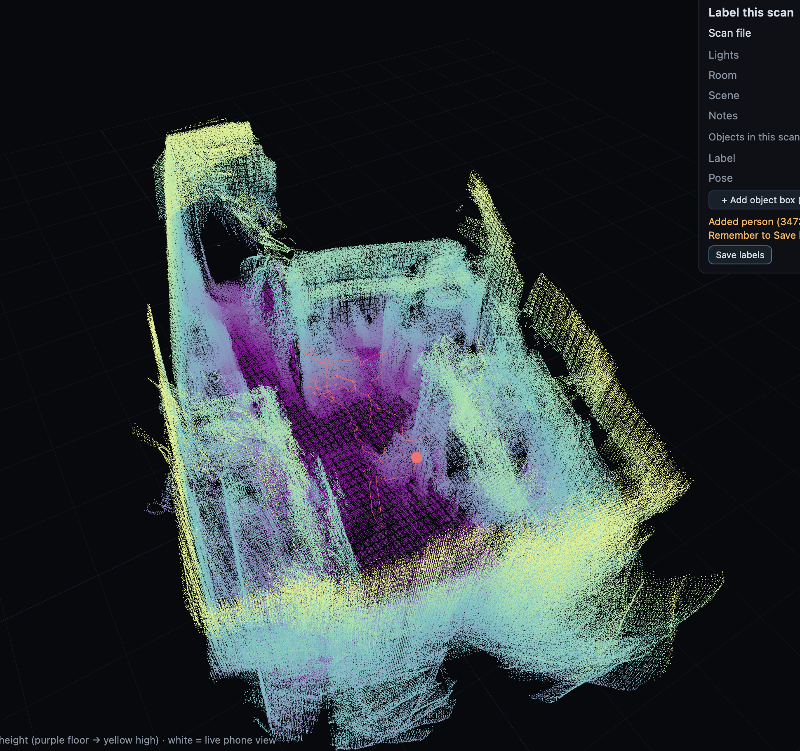
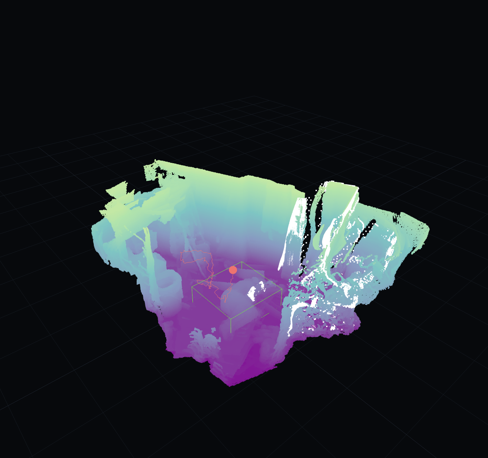
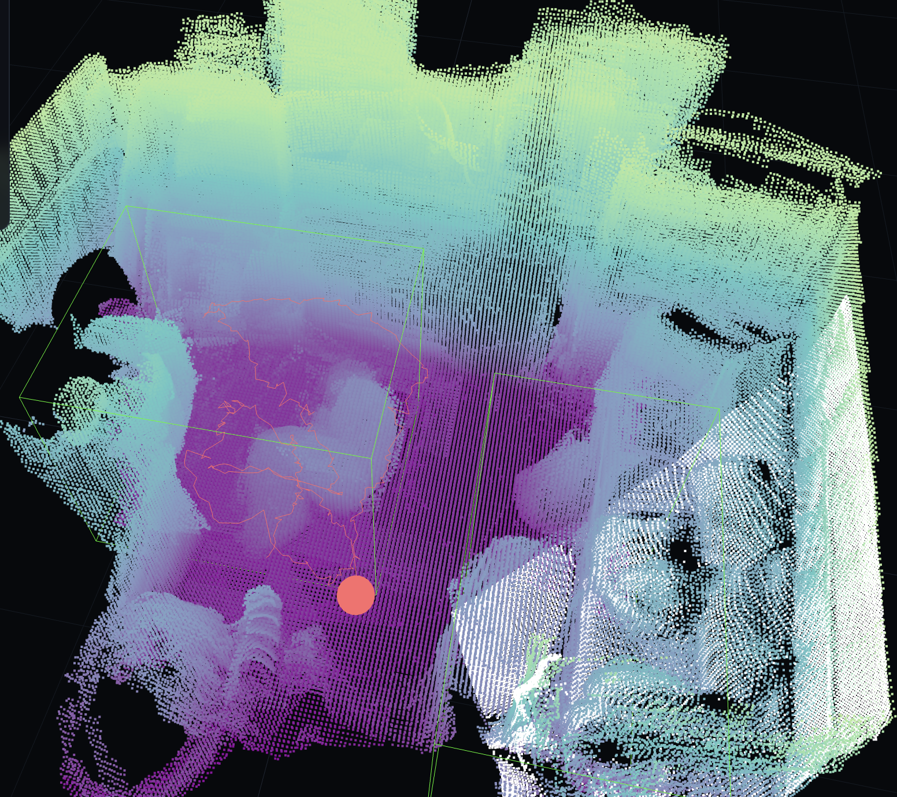

# Final LiDAR scans, 2026-11-15

Screenshots of the mapper's full-density map view (`http://127.0.0.1:8780/`,
see [lidar/README.md](../lidar/README.md)) from scans made with the iPhone
capture app on the last morning of MadHacks. These are the project's final
scan output.

How to read them:

- Each dot is a map point. Colour is height: purple at the floor, through
  blue-green, to yellow at the top.
- White points are the phone's current live frame.
- The thin orange line is the path the phone took. The orange dot is where it
  was when the screenshot was taken.
- Green wireframe boxes are object boxes added by hand in the viewer's
  **Label this scan** panel. They are labels a person drew, not detections.

The room, lighting and scan settings were not recorded with these screenshots,
so they show that the pipeline produces a dense map from a real phone, not how
it performs in darkness. No sonar readings appear in these views.

## Whole-room map, seen from above (10:45)

The floor (purple) is enclosed by walls that rise to yellow. The path stays in
the open floor in the middle of the room.

## The same scan, seen at an angle (10:45)

The **Label this scan** panel is visible at the top right, after a person box
was added.

## One labelled object box (10:46)

One green box around a rounded shape on the floor, next to the phone's path.
White points on the right are the live frame.

## Two labelled object boxes, close up (11:10)

A closer view with two boxes. The live frame (white, right) shows how dense a
single depth frame is compared with the accumulated map.
