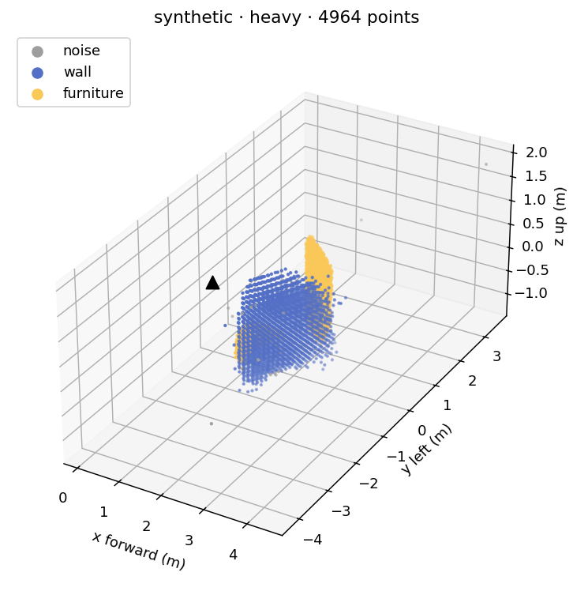

# Status

_Last updated 2026-11-14 (session 5: moved into the EchoSense monorepo as `sonar-ml/`). Update this file whenever something starts or stops working._

## Summary

**No hardware yet.** Perception runs end to end on simulated data:
simulate → 3D map → clusters → classifier → **detections JSON** for the app
team. Four classifiers have been compared; the **random forest is the default**
([ADR-0011](decisions/0011-model-choice-v2.md)). Current synthetic data:
**v3-2000** (2,000 scenes; spherical clustering; SNR intensity; `SonarFrame` 0.2).

**Headline (synthetic):** end-to-end person detection **58%** with
`--pings 4 --bias person=2` (1,000-scene model; precision 0.68), up from 43%
at the start of session 3. **Lying people: 32%** (35% with sweep mode), up from
20% ([ADR-0012](decisions/0012-person-recall.md),
[ADR-0013](decisions/0013-lying-people-sensing.md)).
**Recommended flags everywhere: `--pings 4 --bias person=2`.**

## What works (verified 2026-11-14)

| Component | State | Evidence |
|---|---|---|
| `SonarFrame` save/load + validation | ✅ | `tests/test_frame.py` |
| Simulator physics (specular, occlusion, warm-air range shift, ghosts, FOV) | ✅ | `tests/test_acoustics.py` |
| Realism v2: floor, doorways in walls, absolute noise, held-out `extreme` | ✅ | ADR-0010, `tests/test_inference.py` |
| Volume → points, noise-aware threshold, label carry-over | ✅ | `tests/test_pipeline.py` |
| DBSCAN segmentation, **spherical** (default) or xyz | ✅ (doorways still merge into walls) | ADR-0012 sweep |
| `diagnose`: per-object end-to-end outcomes by pose/range/conditions | ✅ | `tests/test_inference.py` |
| Cost-sensitive decision (`--bias person=2`) | ✅ | ADR-0012 |
| Sensor tilt (`--tilt`), points in level body frame | ✅ | `tests/test_inference.py` |
| Ping averaging (`--pings`), sweep fusion with 2-of-3 view rule (`--sweep --min-views`) | ✅ | `tests/test_sensing.py`, ADR-0013 |
| Noise class (5) + threshold jitter | ✅ | ADR-0009 |
| Random forest (`baseline`, saves `.joblib`) | ✅ | numbers below |
| Deep models BEV / PointNet / voxel (`train`) | ✅ run on MPS, 11-54 s each | numbers below |
| `compare` (all models × seeds) | ✅ | `data/synthetic/v2/compare.json` |
| `detect` → detections JSON v0.1 | ✅ | `tests/test_inference.py`, `data/detections/` |
| Live sensor driver | ❌ stub | waiting on hardware |
| App / demo UI | ❌ not started | can now build against `detect` output |

`pytest`: 27 passed (run with `../.venv/bin/python -m pytest` from `perception/`).

**Environment:** use the repo `.venv` built on the native arm64 Python
(`/usr/local/bin/python3`). Anaconda's Python on the lead's Mac is x86_64 under
Rosetta and installs an old, broken PyTorch. See AGENTS.md §6.

## Results — synthetic only, NOT real data

### Person detection, end to end (`diagnose`, 400 fresh scenes, person bias 2)

| Setup | All people | Standing | Crouching | Lying | Precision | Noise false alarms /200 frames |
|---|---|---|---|---|---|---|
| v2 baseline (bias 1, start of session 3) | 43% | 59% | 38% | 18% | – | – |
| v3-2000, single ping | 53% | 66% | 56% | 20% | 0.76 | 4 |
| 1,000 scenes, single ping | 55% | 66% | 60% | 20% | 0.70 | 5 |
| **1,000 scenes, 4 pings** | **58%** | 70% | 57% | **32%** | 0.68 | 11 |
| 1,000 scenes, 4 pings + sweep 3 (2-of-3 views) | 58.5% | 70% | 57% | 35% | 0.71 | 13 |

What remains for lying people: ~35% undetectable, ~15% called debris.

### Cluster classification, v3-2000 (8,881 clusters, 3 seeds, RF)
Accuracy **0.853 ± 0.005** (clear 0.860, fog 0.852, warm 0.879, heavy 0.804);
person recall 0.73; noise: 4 false object detections in 200 frames.
(Not directly comparable to v2's 0.870: spherical clustering left far fewer,
harder noise clusters; see ADR-0012.)

### v2 model comparison (600 scenes, 3 seeds), still the basis for ADR-0011

| Model | Test acc | person recall | noise recall |
|---|---|---|---|
| **Random forest** | **0.870 ± 0.013** | **0.67** | 0.94 |
| Voxel CNN | 0.853 ± 0.015 | 0.57 | 0.95 |
| BEV CNN | 0.845 ± 0.018 | 0.56 | 0.96 |
| PointNet | 0.824 ± 0.017 | 0.62 | 0.91 |

### Held-out `extreme` condition (never in training), 150 fresh scenes

| | Training-like conditions (RF) | Extreme (RF) | Extreme (BEV) |
|---|---|---|---|
| Objects kept as detections | 482 | **82** | 80 |
| Cluster accuracy | 0.84 | **0.58** | 0.56 |

In extreme conditions most objects never produce a cluster (sensing fails
first), and the classifier generalizes poorly.

### History
v0 (no noise class, relative noise): RF 0.871. v1 (noise class, no floor):
RF 0.882, BEV 0.870, PointNet 0.867, voxel 0.857. Details in
[log 2026-11-14](log/2026-11-14-models-noise-realism.md).

**Caveats:** test data comes from the same simulator; physics constants are
guesses; person geometry is crude; expect a drop on real data.

## Relation to the rest of EchoSense (documented 2026-11-14, nothing wired yet)

- **Web viewer (repo root `src/`).** Renders flat XYZ point arrays with
  **Y up**; our frames are **x forward, y left, z up**. Its feed decoder
  (`decodePreview` in `src/main.js`) is a placeholder awaiting a wire format.
  A natural mapping: `SonarFrame.points[:, :3]` → `points` (axis-converted),
  highest-confidence `person` detection → `target`. Not built; needs the
  viewer owner to agree.
- **`acoustic/` (Ryan).** A real, working capture path using the laptop's
  speaker and mic: an audible 1.05-4.2 kHz, 3 ms chirp, matched-filter range
  per ping (0.65-4.5 m), 5 trials per pose, with direction taken from a
  **manually entered scanner pose**, not from a mic array. Output:
  `sample-scans.csv` (one range per trial) → `aggregate.py` (Databricks or
  local) → `room-map.json` (points with spread/error vs tape reference).
  - Overlap: its matched filter is the first half of our missing
    "raw audio → SonarFrame" step. It has range only (one mic, no angle), so
    it can't fill a `SonarFrame` volume directly.
  - Possible bridges (not built): a `RecordedSource` that turns
    `room-map.json` points into a sparse `SonarFrame` point cloud; use its
    tape-referenced trials to sanity-check our simulator's range error and
    echo strength; reuse its chirp/correlation code for the signal-level sim.
  - Different band: audible kHz from a laptop vs our assumed 40 kHz
    ultrasonic array. Reflection behaviour (specularity, absorption) differs,
    so its numbers don't validate our 40 kHz assumptions one to one.

## Next up (suggested order)

1. **Train the recommended config at 2,000 scenes** (`generate --scenes 2000 --pings 4`) and use it as the demo model; the 1,000-scene numbers above should improve slightly.
2. **Floor removal (ground-plane fit)**: needed before sensor tilt can help, since tilt doubled merges.
3. **Lying people (32-35%)**: lower or handheld scan height in sim; a lying-specific second-stage classifier for low, elongated clusters; breathing micro-motion over several frames.
4. **Doorways merge into walls.** Plane-aware segmentation or volumetric segmentation (3D U-Net).
5. **Viewer can start now** against `detect` output ([interfaces/detections.md](interfaces/detections.md)). Use `--bias person=2` for the demo. The viewer's feed wants flat XYZ points + one `target`; agree a mapping from `SonarFrame.points` + detections (see below).
6. **Re-run `compare` on v3-2000** to see if deep models catch up with more data (ADR-0011 revisit trigger).
7. **Extreme conditions**: wider training ranges; work out sensor range against absorption with hardware.
8. **Signal-level simulation** to pre-build `sources/live.py` and size the mic array.
9. When hardware exists: fill `interfaces/sensor-geometry.md`, implement `sources/live.py`, capture a small real set, fine-tune, report sim vs real.

## Known limitations

- Primitive shapes; 4 furniture types; 3 person poses (no sitting, no arms out).
- Single frame; no temporal information.
- Floor returns are labeled background; no ground removal (floor is only 2-4% of points at current mounting).
- Floor-level objects within ~2.2 m are outside the ±30° vertical field of view.
- No frequency content in the simulator (no time-frequency echo features).
- Detection `confidence` is uncalibrated random-forest probability.
